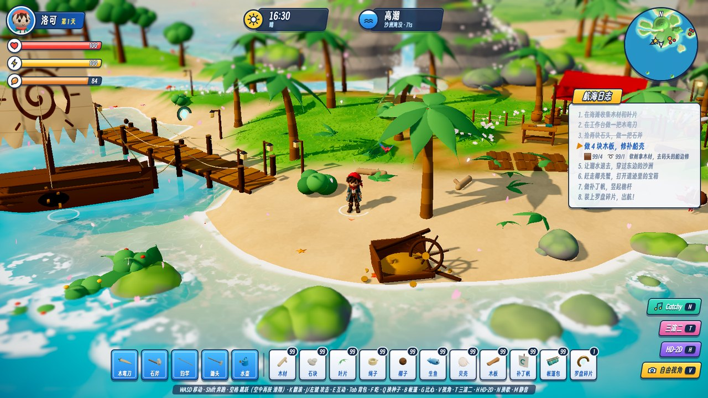
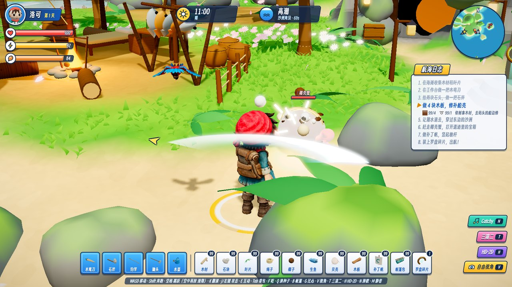
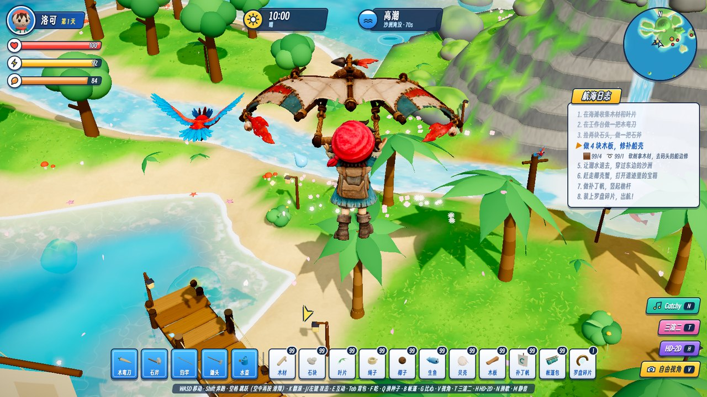
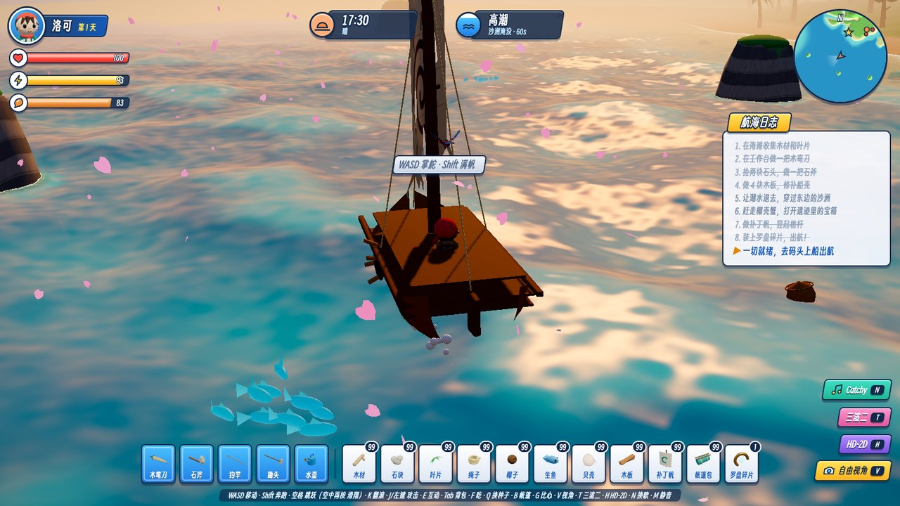
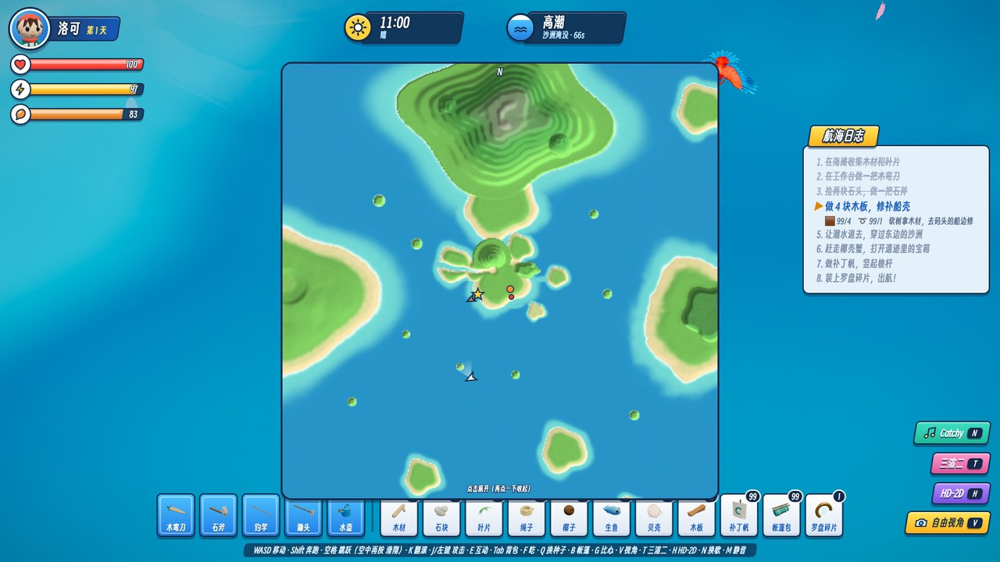

# 漂岛奇航 · Pirate Survival

一个用 Three.js 写的网页 3D 海岛生存小游戏原型：在「晴帆岛」收集材料、做工具、打椰壳蟹、修船出航，出航后可以自由航海。

A browser 3D island-survival prototype built with Three.js — gather, craft, fight coconut crabs, repair your boat and set sail.



## 截图 / Screenshots

| | |
|---|---|
|  战斗：三连击刀光、命中火花 |  从高处滑翔 |
|  修好船后自由航海 |  小地图 / 整岛地图 |

## 运行 / Run

```sh
cd game
npm install
npm run dev      # http://127.0.0.1:4173
npm run build    # 静态文件输出到 game/dist/
```

需要支持 WebGL2 的桌面浏览器。`webgpu.html` 是一个 WebGPU 技术预览页（compute shader 海浪、GPU 雨、20 万根草）。

## 内容 / Features

- 采集 → 制作 → 退潮开路 → 战斗 → 修船出航的完整任务线，自动存档
- 走 / 跑 / 跳 / 滑翔 / 攀爬 / 游泳，模型自带的走、跑、游泳、坐、挥手、比心等动作
- 昼夜循环、天气（晴 / 阴 / 雨）、Gerstner 海浪、瀑布河流、鱼群、海鸥、樱花瓣
- 烹饪、钓鱼、耕种、搭帐篷睡觉，出航后自由驾船
- 战斗特效（刀光、命中火花、冲击波、预警圈）、小地图、HD-2D / 三渲二后期
- 测试模式（标题页勾选）：解锁全部工具与材料

操作说明见 [game/README.md](game/README.md)。

## 目录 / Layout

| 路径 | 内容 |
|---|---|
| `game/` | 游戏源码（Vite + Three.js） |
| `art/concept/` | 概念美术图 |
| `漂岛奇航_游戏概念与美术资源清单.md` | 游戏概念与美术资源清单 |
| `index.html`、`概念板说明.md` | 概念设计板 |

## 许可 / License

- 代码：[MIT](LICENSE)
- 背景音乐：CC0，来源见 [game/public/music/CREDITS.md](game/public/music/CREDITS.md)
- 字体：得意黑 Smiley Sans，SIL Open Font License 1.1
- 3D 模型（`game/public/models/`）和概念图由作者用 AI 工具生成，随仓库一起以 MIT 发布
