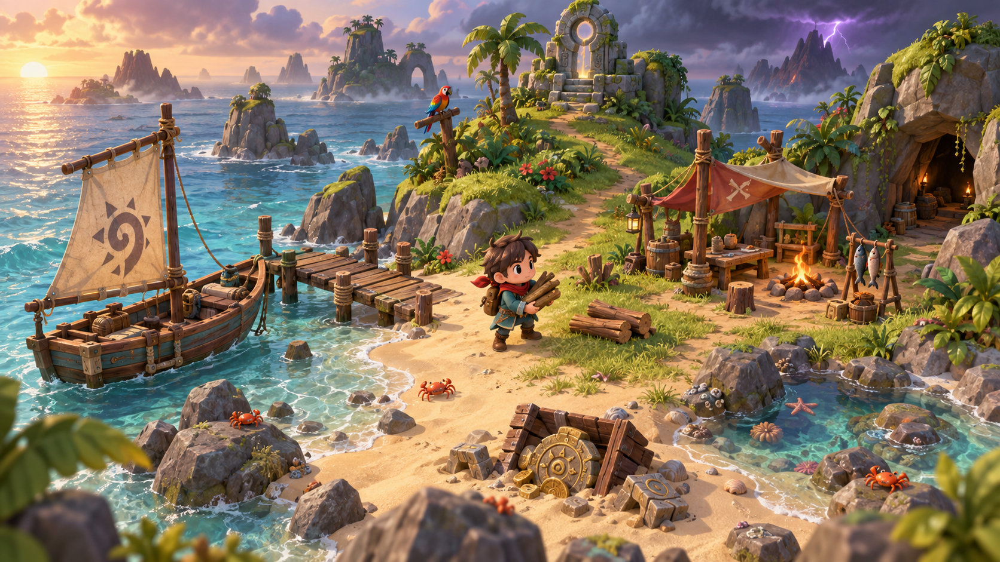
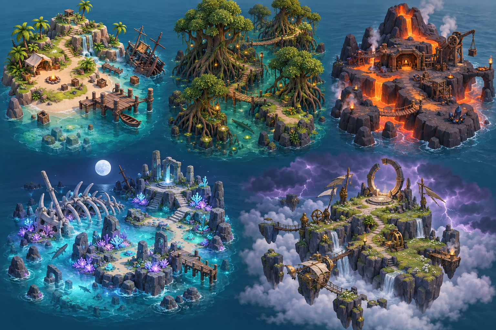
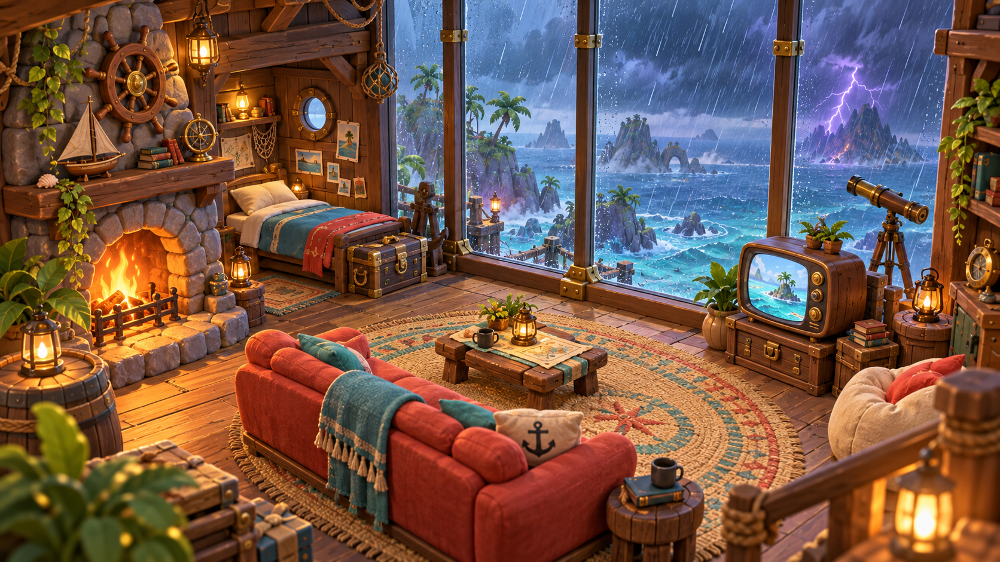
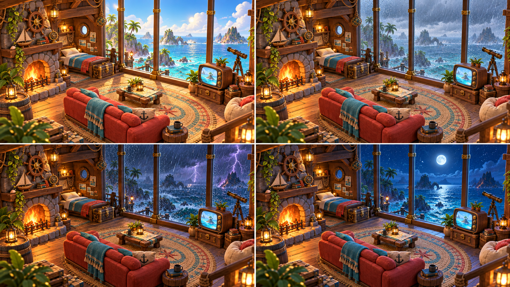
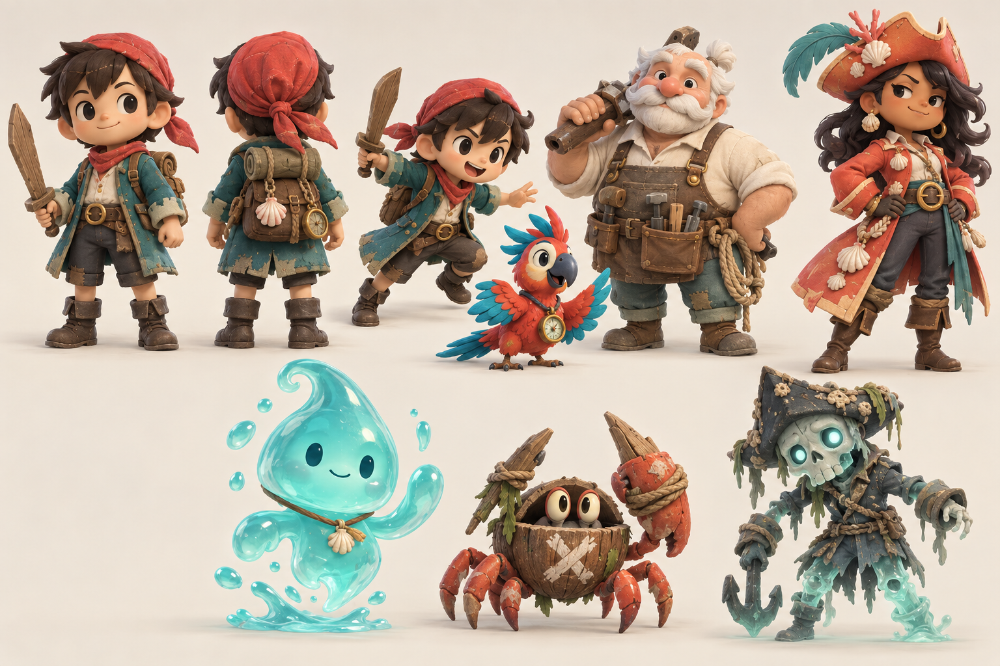
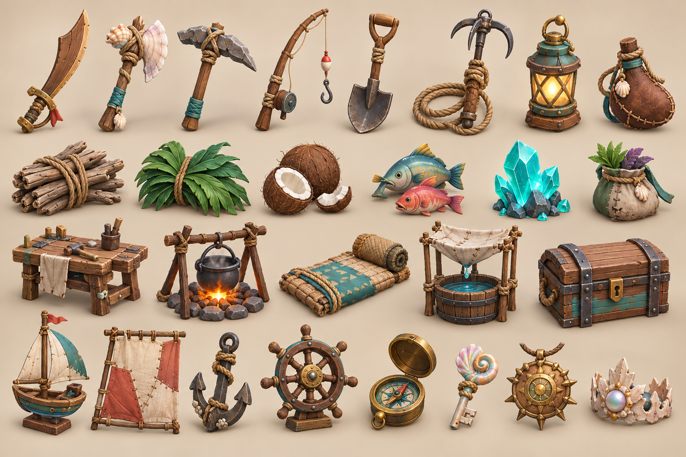
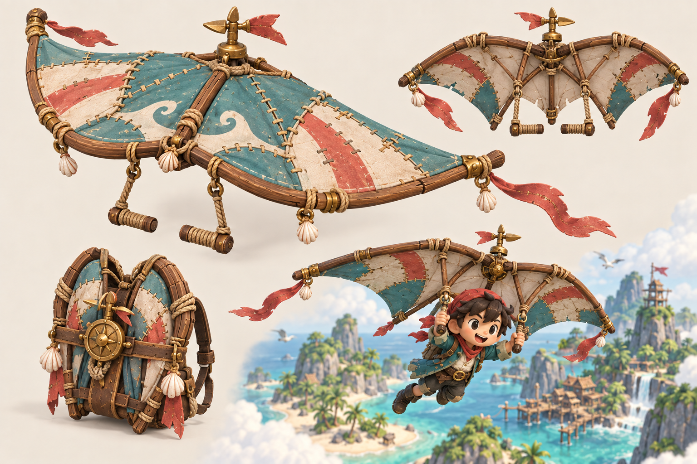

# 《漂岛奇航》游戏概念与美术资源清单

> 版本：概念提案 v0.1  
> 类型：单人 3D 俯视角海盗生存 × 航海探索 × 轻解谜  
> 美术关键词：微缩玩具、圆润手办、手工材质、明亮海岛、低压力生存  
> 原则：提炼“小比例角色、微缩景观、柔和材质、俯视镜头”的观感，但不复制任何现有角色、图标、场景或剧情。

## 1. 一句话概念

一名遭遇魔法风暴的小海盗，驾驶由沉船残骸不断改装而成的“移动船屋”，在会随潮汐改变道路的漂流群岛上采集、建造、战斗和解谜，最终修复失落的潮汐罗盘。

## 2. 产品定位

| 项目 | 建议 |
|---|---|
| 核心体验 | 轻松但有目标的荒岛求生；每次出航都能带回明确的新能力或船只升级 |
| 目标玩家 | 喜欢可爱冒险、收集建造、短流程探索和轻度动作的玩家 |
| 平台 | PC 与主机手柄优先；后续可评估掌机适配 |
| 单局节奏 | 15–25 分钟完成一次“出航—探索—返船—升级” |
| 主线体量 | 8–12 小时；完成五座潮汐神殿后进入结局 |
| 镜头 | 35°–45° 固定俯视角，有限旋转；探索时轻微跟随，地标处拉远 |
| 操作 | 移动、攻击、闪避、工具、互动、快捷轮盘；尽量不超过六个高频按键 |

## 3. 三个设计支柱

### 3.1 潮汐会“重画”地图

- 每个岛有高潮、退潮两种可探索状态。
- 退潮露出沙洲、沉船舱、采集点和洞穴入口；高潮开启漂浮平台、水道与船只捷径。
- 基础周期建议 6 分钟，玩家可在神龛处主动推进一次潮汐，避免原地等待。
- 潮汐变化必须先有视觉和音效预告，再改变碰撞与导航。

### 3.2 船就是玩家的家

- 船承担传送、仓储、睡眠、烹饪、制作和展示收藏品。
- 船体升级既改变属性，也 visibly 改变模型：补丁小艇 → 双桅帆船 → 潮汐航舰。
- 船只受损只降低航速与货舱效率，不直接清空进度。

### 3.3 生存有压力，但不惩罚重复劳动

- 只保留生命、体力、饱腹、船体耐久四项核心状态。
- 饱腹影响体力恢复，不会直接饿死；食物更像临时增益选择。
- 失败后在船上醒来，保留装备与关键物品，仅掉落本次未存放资源的一部分。
- 不设置强制饮水、工具永久损坏或大规模基地维护。

## 4. 核心循环

**观察海图与天气 → 选择岛屿 → 航行规避风浪 → 登岛采集/战斗/解谜 → 利用潮汐进入新区域 → 获得罗盘碎片与稀有材料 → 返回船屋制作和升级 → 解锁更远海域。**

每次循环至少兑现一种进展：新工具、新船件、新配方、新捷径、剧情线索或外观收藏。

## 5. 世界观与主线

“碎潮群岛”曾由五座潮汐神殿稳定海流。海盗王为寻找永不沉没的宝藏，拆走了神殿核心，导致岛屿在风暴中漂移重组。主角的船被卷入群岛，只剩一枚失灵的黄铜罗盘和会说话的鹦鹉伙伴。

主线目标：修复五枚潮核，重组潮汐罗盘，并在终局选择：离开群岛、成为新的守潮人，或把安全航路开放给所有漂泊者。

叙事基调轻快，主题是“家不是找到的岛，而是一路修好的船”。

## 6. 系统设计

### 6.1 采集与制作

| 层级 | 主要材料 | 解锁内容 |
|---|---|---|
| 漂流层 | 木材、叶片、石块、椰子、鱼 | 营火、木剑、斧、钓竿、基础修船 |
| 珊瑚层 | 贝壳、树脂、发光珊瑚、潮晶 | 抓钩、潜水钟、雨水器、强化船帆 |
| 古代层 | 星铜、风暴玻璃、潮核碎片 | 罗盘能力、抗风暴船体、神殿机关工具 |

- 制作配方控制在 35–45 个，保持每件物品有明确用途。
- 工具不永久损坏；升级提高采集效率、作用范围或开启新交互。
- 工作台负责工具与船件，营火负责食物，潮汐祭坛负责魔法能力。

### 6.2 战斗

- 基础动作：轻击三连、蓄力击、闪避、工具技、伙伴技。
- 敌人使用夸张预备动作，攻击前 0.6–1.2 秒给出颜色与姿态提示。
- 武器只做三类：弯木刀、鱼叉、潮汐法器；用功能差异代替大量数值装备。
- 无血液与肢解；敌人被击败后化为泡沫、贝壳或散落木片。

### 6.3 航海与船只升级

| 模块 | 作用 | 可视化变化 |
|---|---|---|
| 船壳 | 耐久、撞击礁石容错 | 木板层数、金属包边、船首像 |
| 船帆 | 航速、逆风能力 | 补丁帆、双帆、风暴帆 |
| 船舱 | 仓储、工作台等级 | 箱柜、棚顶、陈列架 |
| 导航 | 海图范围、风暴预警 | 罗盘台、望远镜、潮汐仪 |
| 伙伴位 | 自动拾取或战斗辅助 | 鹦鹉栖木、潮灵水盆 |

### 6.4 天气与昼夜

- 晴天：基础探索；雨天：植物资源增加、火焰机关关闭；风暴：稀有潮晶出现、航行风险上升。
- 一昼夜建议 24 分钟；夜间改变生物与机关，不降低基础可见度。
- 营火可推进到清晨或夜晚，防止任务被时间强卡。

## 7. 五个主要场景

| 区域 | 视觉锚点 | 核心玩法 | 资源 | 主要威胁 |
|---|---|---|---|---|
| 晴帆岛 | 沉船、白沙滩、瀑布营地 | 教学、建造第一座码头 | 漂流木、椰子、石块 | 椰壳蟹、涨潮困路 |
| 根潮沼泽 | 巨型红树林、绳桥、萤火 | 利用高潮乘筏穿根洞 | 树脂、药草、泥鳅 | 毒泡植物、陷泥 |
| 熔锚火山 | 黑岩、熔岩渠、废弃锻炉 | 转动水闸冷却熔岩 | 星铜、火椒、黑曜石 | 蒸汽喷口、熔壳蟹 |
| 月骨珊瑚滩 | 巨兽骨架、发光珊瑚、沉船墓碑 | 退潮重走幽灵船航线 | 珍珠、幽光藻、古钥匙 | 幽灵水手、幻潮 |
| 风冠神殿 | 云海浮岛、圆环遗迹、风车机关 | 调整风向连接浮桥 | 风暴玻璃、潮核 | 雷击区、终局守卫 |

### 7.1 新增安全屋：风暴观景屋

风暴观景屋是一处位于高崖或大型船舱内的室内安全区。它承担休息、天气观察、存档与轻度整理功能，让玩家在恶劣天气中仍能直观看见世界继续运作。

- **超大落地玻璃窗：** 占据整面外墙，必须看见天空、海面、岛屿、云层和降水；玻璃反射保持克制，不遮挡室外信息。
- **壁炉区：** 提供暖色主光、烹饪或推进时间功能；火焰会随强风天气产生轻微抽动，但室内不受雨水影响。
- **睡眠区：** 单人小床与储物箱形成紧凑休息角；睡眠可将时间推进到清晨或指定天气结束后。
- **休闲区：** 沙发、低桌与大地毯组成视觉中心，电视显示天气预报、收集进度或海图提示。
- **观察区：** 望远镜或天气仪靠近窗边，允许玩家查询下一段天气、风向与潮汐。
- **导航要求：** 家具之间保留至少 1.5 m 可行走宽度；玩家从入口可直接看见窗、壁炉和互动家具。

| 状态 | 窗外表现 | 室内联动 |
|---|---|---|
| 晴天早晨 | 高饱和天空、平静海面、清晰远岛 | 自然光增强，壁炉亮度降低，玻璃基本无水痕 |
| 小雨 | 灰蓝云层、细雨、轻微海浪 | 玻璃出现细密水滴与缓慢水痕，室内保持柔和中性光 |
| 雷暴 | 斜向暴雨、强风浪、远处闪电 | 闪电短暂照亮室内，玻璃雨痕加速，壁炉暖光对比增强 |
| 月夜 | 星空、月亮倒影、深蓝海面 | 窗口投射冷青月光，壁炉与台灯成为局部暖色焦点 |

实现时应复用同一套室外关卡天气参数，而不是在窗外播放固定视频。落地窗使用室内外分层玻璃材质：外层负责水滴、流痕与闪电反射，内层只保留轻微高光，以保证从室内观察天气的可读性。

## 8. 角色与生物方向

| 角色 | 功能 | 造型关键词 |
|---|---|---|
| 主角“洛可” | 玩家角色 | 红头巾、青绿旧外套、木弯刀、贝壳挂件；大头短肢 |
| 鹦鹉“针针” | 指路、标记资源、伙伴技 | 珊瑚红与青蓝羽毛、黄铜罗盘吊坠 |
| 船匠“伯尔” | 船只升级与制作教学 | 圆体型、白胡子、深色围裙、工具腰带 |
| 对手船长“玛蕾” | 竞争、支线与后期盟友 | 珊瑚橙长外套、贝壳帽饰、锐利但友善的轮廓 |
| 潮灵“滴答” | 潮汐能力与世界观 | 透明水滴体、简单表情、贝壳项链 |
| 椰壳蟹 | 初级敌人 | 椰壳躯干、红色蟹钳、绳结武装 |
| 藤壶幽灵 | 中级敌人 | 破旧海盗衣、发光水体下肢、锚形武器 |

## 9. 道具视觉方向

- 轮廓优先：道具缩到 64 px 高度时仍能仅凭外形识别。
- 功能色统一：采集工具用青绿布条，任务物品用黄铜圆环，魔法物品用青色内发光，危险物用珊瑚橙。
- 所有工具保留“漂流材料拼装”的结构逻辑：木、绳、贝壳、旧黄铜最多三种主材组合。
- 不在模型上依赖小字；信息通过轮廓、颜色、粒子和动画表达。

### 9.1 主角专属装备：潮风翼

“潮风翼”是一件由船帆、弯曲轻木、绳索、贝壳扣件和黄铜风向机构制成的可折叠滑翔装备。展开后采用宽阔的魔鬼鱼式轮廓，与常见矩形降落伞或羽翼造型区分；折叠后固定在主角背包外侧。

| 项目 | 设计规格 |
|---|---|
| 展开尺寸 | 约 2.4 m 宽；主角双手握住两个绳缠木柄 |
| 视觉识别 | 青绿色主帆、奶油色补丁、珊瑚红条纹与尾带、中央黄铜风向标 |
| 解锁方式 | 修复风冠神殿外围的第一座风向机关后，由船匠完成制作 |
| 基础能力 | 高处跃下展开；降低下落速度；保持向前滑翔；可借助上升气流抬升 |
| 天气联动 | 顺风提高水平速度；小雨略降低操控；雷暴中风向突变，但可借强上升气流到达隐藏区域 |
| 升级方向 | 扩展帆面延长滞空；贝壳导流孔提高转向；风暴玻璃轴承增强抗乱流能力 |

动画状态建议：背包待机、取出、展开、进入滑翔、左/右倾转、上升气流、失速、收拢落地和强风挣扎，共 10 组。展开动画控制在 0.35–0.45 秒，避免操作迟滞；落地前 0.8 m 自动收拢。

模型建议使用展开与折叠两套网格共享材质，展开态约 18k–25k 三角面。骨骼至少包含中央轴、左右主梁、四个帆面控制骨和两条尾带；近景允许轻量布料摆动，远景改用顶点动画。中央风向标与贝壳导流孔必须独立旋转，便于反馈风向和上升气流。

## 10. 美术风格规范

### 10.1 造型

- 角色头身比约 1:2.5，手脚略大，面部细节极简。
- 环境垂直夸张 15%–25%，树冠、岩石与建筑形成清晰层级。
- 所有尖角倒圆；危险物可使用三角形，但必须保持厚实、玩具化。
- 场景以 1 m 网格搭建；路径宽度至少 2.5 m，主交互区至少 5 m。

### 10.2 材质与光照

- 以哑光黏土、涂漆木头、布料和半透明水体为主；金属仅做局部高光。
- 纹理保留轻微手绘颗粒与边缘磨损，避免写实污渍和高频噪点。
- 主光柔和、阴影边缘宽；角色始终比地面亮约 10%–15%。
- 水面使用低频波纹、浅滩颜色分层和白色泡沫线，不追求写实海浪。

### 10.3 建议色板

| 用途 | 色值 |
|---|---|
| 海水主色 | `#27B7C7` |
| 深海阴影 | `#176A7A` |
| 植被主色 | `#4F9A55` |
| 沙滩 | `#EACB8F` |
| 珊瑚强调 | `#E85D4A` |
| 布料青绿 | `#237A78` |
| 黄铜 | `#C7923E` |
| 风暴紫 | `#54436F` |
| 魔法青光 | `#6DE7E2` |

### 10.4 动画与特效

- 动画使用明显的预备、挤压、回弹；待机动作幅度低，交互动作幅度高。
- 角色移动保持脚步清晰，不做过度滑行；转身允许 4–6 帧夸张扭身。
- 命中反馈由白色闪光、贝壳碎屑和短促停顿组成，不使用血液。
- 潮汐变化使用水线推进、漂浮物抬升、环境音渐强三层反馈。

### 10.5 VI 标题字标

[下载白色透明底《漂岛奇航》标题字标（精修版）](art/vi/02-title-wordmark-white-refined.png)

- 中文主标题固定为“漂岛奇航”，英文副标题固定为“DRIFT ISLES”。
- 中文采用具有海风与帆面弧度的高级手写字形；英文使用小号大写字母与宽字距，不与中文争夺视觉层级。
- 推荐母版为纯白单色透明 PNG，尺寸 1983 × 793 px，带 Alpha 通道；初稿另存为 `art/vi/01-title-wordmark-white.png` 供风格对照。
- 建议最小显示宽度 360 px；四周安全区不小于中文字高的 20%。
- 优先放置于深海蓝、风暴紫、青绿色或暗化场景上；禁止添加渐变、描边、投影、斜切或压缩变形。
- 浅色背景上应先增加独立的深色遮罩层，不直接修改白色母版。

## 11. 美术资源总清单

优先级定义：**P0** 为可玩垂直切片必需；**P1** 为完整首发内容；**P2** 为丰富度与长期内容。

### 11.1 角色、敌人与动画

| 资源组 | 数量建议 | 优先级 | 制作备注 |
|---|---:|---|---|
| 主角基础模型 | 1 | P0 | 含面部表情形态键、装备挂点、换色材质 |
| 主角服装套装 | 5 | P1/P2 | 海滩、沼泽、火山、幽灵、风暴主题 |
| 鹦鹉伙伴 | 1 | P0 | 飞行、栖息、拾取、指向、伙伴技 |
| 潮灵伙伴 | 1 | P1 | 半透明材质与水体拖尾 |
| 核心 NPC | 6 | P1 | 船匠、对手船长、厨师、制图师、守潮人、商贩 |
| 次要 NPC 变体 | 6 | P2 | 共享骨骼与基础动作 |
| 普通敌人 | 10 | P0/P1 | 每生物群系 2 类，允许材质变体 |
| 精英敌人 | 5 | P1 | 普通敌人骨架强化变体 |
| 区域 Boss | 5 | P1 | 每区 1 个，独立剪影和场地机制 |
| 环境动物 | 8 | P1/P2 | 螃蟹、海鸥、鱼、龟、萤火虫等 |

动画预算建议：主角 45–60 条；伙伴 18–24 条；NPC 每套骨架 12–18 条；普通敌人每类 10–14 条；Boss 每只 22–30 条。

### 11.2 环境模块

| 资源组 | 数量建议 | 优先级 | 内容 |
|---|---:|---|---|
| 通用地形模块 | 30 | P0 | 沙地、草地、岩壁、悬崖、浅滩、洞口、坡道 |
| 通用建筑模块 | 24 | P0/P1 | 木墙、地板、码头、绳桥、棚顶、门窗、梯子 |
| 海岸装饰 | 28 | P0 | 棕榈、灌木、贝壳、浮木、礁石、泡沫线 |
| 晴帆岛专属 | 24 | P0 | 沉船套件、瀑布、教学营地、基础神龛 |
| 根潮沼泽专属 | 28 | P0/P1 | 巨根、吊桥、水生植物、泥潭、萤火灯 |
| 熔锚火山专属 | 30 | P1 | 熔岩渠、锻炉、轨道、蒸汽口、黑岩植被 |
| 月骨珊瑚滩专属 | 30 | P1 | 骨架、墓碑、珊瑚、沉船、月光神龛 |
| 风冠神殿专属 | 32 | P1 | 浮岛、圆环门、风车机关、云瀑、黄铜机械 |
| 船只阶段模型 | 3 | P0/P1 | 补丁小艇、双桅船、潮汐航舰；共享基础骨架 |
| 室内小场景 | 6 | P1 | 船舱、洞穴、锻炉室、商店、神殿前厅、终局室 |

### 11.3 道具与交互物

| 资源组 | 数量建议 | 优先级 | 示例 |
|---|---:|---|---|
| 手持工具 | 8 | P0 | 木刀、斧、镐、铲、钓竿、抓钩、灯、鱼叉 |
| 主角滑翔装备 | 1 | P1 | 潮风翼展开/折叠网格、骨骼、10 组动画与风向反馈 |
| 基础资源 | 12 | P0 | 木、石、叶、绳、椰子、鱼、药草、树脂 |
| 稀有资源 | 8 | P1 | 潮晶、星铜、珍珠、幽光藻、风暴玻璃 |
| 营地设施 | 10 | P0/P1 | 工作台、营火、睡垫、雨水器、晾鱼架、箱子 |
| 船上设施 | 12 | P1 | 舵、锚、帆、罗盘台、望远镜、陈列架、灶台 |
| 宝箱与容器 | 6 | P0 | 木箱、金属箱、漂流桶、贝壳匣等 |
| 解谜机关 | 14 | P1 | 压板、潮门、风车、镜面、转盘、升降平台 |
| 任务与收藏品 | 20 | P1/P2 | 罗盘碎片、瓶中信、船徽、藏宝图、纪念物 |
| 食物模型 | 12 | P1 | 烤鱼、椰汁、海草汤、火椒串等 |

### 11.4 特效、UI 与展示资源

| 资源组 | 数量建议 | 优先级 | 内容 |
|---|---:|---|---|
| 常规 VFX | 24 | P0/P1 | 砍击、命中、采集、脚步、泡沫、火焰、蒸汽、雨 |
| 魔法 VFX | 12 | P1 | 潮汐切换、神龛、罗盘扫描、传送、Boss 技能 |
| 天气 VFX | 8 | P0/P1 | 小雨、暴雨、闪电、雾、风线、云影 |
| UI 图标 | 70–90 | P0/P1 | 资源、工具、食物、状态、任务、地图标记 |
| HUD 套件 | 1 | P0 | 生命、体力、饱腹、快捷栏、交互提示 |
| 菜单套件 | 1 | P0/P1 | 背包、制作、海图、船只升级、设置 |
| 对话头像 | 12–18 | P1 | 每核心角色 2–3 个表情 |
| 加载与章节插画 | 6 | P2 | 五区域加终局 |

## 12. 3D 制作规格建议
 
| 类型 | 三角面预算 | 贴图建议 | LOD |
|---|---:|---|---|
| 主角 | 25k–35k | 2K 主贴图 + 独立眼睛/表情 | 3 级 |
| 伙伴/核心 NPC | 12k–25k | 1K–2K | 2–3 级 |
| 普通敌人 | 8k–18k | 1K | 2 级 |
| Boss | 35k–60k | 2K | 3 级 |
| 小型道具 | 300–3k | 256–512 图集 | 1–2 级 |
| 大型交互物 | 3k–12k | 1K | 2 级 |
| 环境模块 | 1k–15k | 1K–2K 图集/可平铺 | 2–3 级 |
| 船只 | 30k–55k | 2K + 装饰图集 | 3 级 |

- PBR 通道：Base Color、Normal、ORM；风格化材质允许烘焙柔和 AO。
- 角色与交互物描边不依赖几何外轮廓，优先通过亮度分离和接触阴影保证可读性。
- 建议复用 3 套角色骨架：小型人类、圆体型人类、幽灵/怪物。
- 所有交互物统一 Pivot 规则；门轴、转盘、船舵等必须在真实旋转中心。

## 13. 垂直切片范围

目标：30–45 分钟可完整体验，验证美术、潮汐与船屋循环。

**P0 内容：**

- 晴帆岛完整一张，根潮沼泽前半张。
- 主角、鹦鹉、船匠、椰壳蟹、藤壶幽灵共 5 个角色/敌人模型。
- 木刀、斧、钓竿、灯、工作台、营火、睡垫、箱子等 24 个核心道具。
- 高潮/退潮各一套导航变化，一种晴天到暴雨的天气切换。
- 小艇两级外观、12 个配方、1 个潮汐神龛、1 场小 Boss 战。
- 完整 HUD、背包、制作、海图和船只升级四个界面。

验收标准：玩家无文字教程也能在 10 分钟内理解“采集—制作—修船—退潮开路”；镜头缩到实际游戏尺寸时，角色、资源和危险仍能一眼区分。

## 14. 推荐制作顺序

1. 灰盒实现潮汐、登岛、船只返航和基础采集。
2. 锁定主角比例、镜头角度与一块 20 m × 20 m 的晴帆岛视觉样板。
3. 完成主角、椰壳蟹和 12 个 P0 道具，验证材质与动画规范。
4. 搭建晴帆岛模块库，再复制同一指标到根潮沼泽。
5. 完成船屋升级、制作 UI 与天气 VFX，形成垂直切片。
6. 通过切片评估后，再批量扩展五区资源，避免过早生产不可复用资产。

## 15. 当前概念图使用说明

- 四张图用于统一气质、轮廓、材质和色彩，不应直接当作最终模型正交图。
- 正式建模前，主角、船只、Boss、神殿机关需补前/侧/后三视图和比例标尺。
- 场景板用于确认生物群系差异；实际关卡应先通过灰盒验证潮汐前后都可导航。
- 图中出现的符号仅作气氛参考；最终需建立一套原创的潮汐文字与图腾系统。
